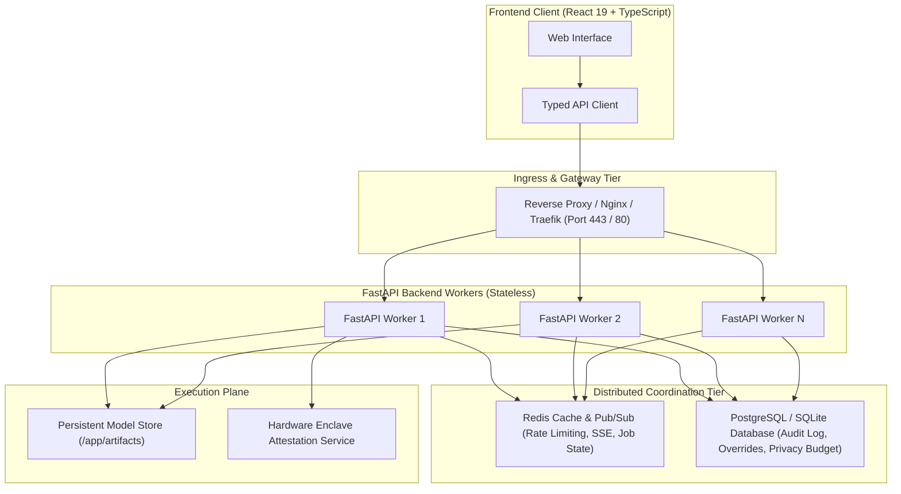

# TrustFed — Architectural Audit & Remediation Roadmap

This document outlines the architectural audit findings for the TrustFed platform, identifying architectural bottlenecks, design anti-patterns, simulation vs. production gaps, and provides a prioritized step-by-step remediation roadmap.

---

## 1. Executive Summary & Audit Overview

TrustFed presents an enterprise privacy-preserving federated fraud intelligence architecture featuring:
- Machine Learning (GBDT/ONNX inference)
- Google Gemini LLM explainability
- SecAgg+ secure multiparty computation
- Differential Privacy (Rényi DP)
- TEE Hardware Enclaves

While the functional prototypes and algorithmic implementations are sound, several critical **architectural discrepancies** exist between the production claims and the actual code execution environment. These issues affect reliability, scalability, security, and multi-process concurrency.

---

## 2. Identified Architectural Issues

### 2.1 Multi-Worker Concurrency & State Inconsistency
- **In-Memory Job State**: In [`backend/job_queue.py:82`](backend/job_queue.py:82), the [`AsyncJobManager`](backend/job_queue.py:75) class holds jobs in a local Python dictionary `self._jobs: Dict[str, BatchJob] = {}`. In [`Dockerfile:58`](Dockerfile:58), Uvicorn is executed with `--workers 4`. When a client initiates an asynchronous batch screening request via worker 1, worker 1 creates the job in its local memory. When the client subsequent polls `GET /api/jobs/{job_id}`, round-robin routing will frequently hit workers 2, 3, or 4, resulting in premature `404 Not Found` errors.
- **In-Memory Rate Limiting**: In [`backend/rate_limiter.py:36`](backend/rate_limiter.py:36), [`SlidingWindowRateLimiter`](backend/rate_limiter.py:28) maintains client sliding windows within `self._history: Dict[Tuple[str, str], collections.deque]`. Each worker maintains isolated state, allowing clients to send 4x their rate quota. The bundled Redis container defined in [`docker-compose.prod.yml:38`](docker-compose.prod.yml:38) is ignored by the rate limiter.
- **In-Memory WebSocket Streams**: In [`backend/stream_engine.py:34`](backend/stream_engine.py:34), client WebSocket connections and anomaly injection states exist solely within a single worker process rather than through a distributed pub/sub backbone.

### 2.2 Persistence & Database Anti-Patterns
- **Local Flat JSON Files for Critical State**: The platform stores critical operational data in raw JSON files under [`backend/artifacts`](backend/artifacts), including:
  - [`backend/artifacts/investigator_overrides.json`](backend/artifacts/investigator_overrides.json)
  - [`backend/artifacts/rdp_privacy_ledger.json`](backend/artifacts/rdp_privacy_ledger.json)
  - [`backend/artifacts/feature_flags.json`](backend/artifacts/feature_flags.json)
  - [`backend/artifacts/admin_audit_log.json`](backend/artifacts/admin_audit_log.json)
- **Lost Update Race Conditions**: Multiple Uvicorn processes reading and writing to the same JSON files via temporary file replacement (`os.replace` or atomic write wrappers) can still lead to lost updates when concurrent writes interleave.
- **Simulated Connection Pool**: [`backend/db_pool.py:11`](backend/db_pool.py:11) implements [`ConnectionPoolThrottle`](backend/db_pool.py:11) as an in-memory `threading.BoundedSemaphore(max_connections)`. It does not connect to any actual persistent SQL or NoSQL database.
- **Container Ephemerality & Data Loss**: In [`docker-compose.prod.yml:4`](docker-compose.prod.yml:4), only Redis persists data in a volume (`redis-data`). The backend container has no persistent volume mounted for `backend/artifacts`. Any container restart or deployment update clears newly added investigator overrides and privacy budget ledger history.

### 2.3 Simulated vs. Production Cryptographic Boundaries
- **Software-Simulated Hardware Enclaves (TEE)**: [`backend/enclave_attestation.py:24`](backend/enclave_attestation.py:24) simulates AWS Nitro / Intel SGX remote attestation documents using local HMAC-SHA256 (`ENCLAVE_SIGNING_SECRET`). In an actual deployment, remote attestation requires verification of hardware-signed certificates against the AWS Nitro or Intel SGX Root CA.
- **In-Process Silo Simulation for SecAgg+**: In [`backend/secagg_engine.py:111`](backend/secagg_engine.py:111), [`SecAggSiloActor`](backend/secagg_engine.py:111) instances are instantiated within the same Python process rather than operating as independent network services with TLS mutual authentication.
- **Hardcoded Cryptographic Keys**:
  - In [`backend/compliance_engine.py:26`](backend/compliance_engine.py:26), `SECRET_KEY = b"trustfed-phase3-compliance-master-seal-secret-2026"` is hardcoded instead of pulling from the centralized [`Settings.secret_key`](backend/config.py:68).
  - In [`backend/enclave_attestation.py:15`](backend/enclave_attestation.py:15), a static default fallback secret `"trustfed-aws-nitro-tee-signing-secret-prod-2026"` is defined.

### 2.4 Monolithic API Controller
- **2,380+ Line God Controller**: [`backend/risks_api.py:196`](backend/risks_api.py:196) consolidates authentication, server-sent events (SSE), batch CSV parsing, job triggering, ONNX fallback, telemetry websockets, and model loading into a single source file.
- **Port and Entrypoint Inconsistencies**:
  - [`run.sh:38`](run.sh:38) launches Uvicorn on port `8000`.
  - [`run_dev.bat:11`](run_dev.bat:11) launches Uvicorn on port `8001`.
  - [`Dockerfile:58`](Dockerfile:58) exposes and serves port `8001`.
  - [`frontend/src/risk_api_client.js:7`](frontend/src/risk_api_client.js:7) runs a brute-force ping across ports 8000 and 8001 on every launch.

### 2.5 Frontend API Gateway & Security
- **Dynamic Port Guessing Latency**: Probing multiple candidate URLs in [`frontend/src/risk_api_client.js:37`](frontend/src/risk_api_client.js:37) delays initial client rendering and triggers console errors.
- **Client-Side Sensitive Key Storage**: API tokens are stored in unencrypted browser `localStorage` in [`frontend/src/risk_api_client.js:16`](frontend/src/risk_api_client.js:16), exposing them to Cross-Site Scripting (XSS).

---

## 3. Target Architecture Diagram

---

## 4. Prioritized Remediation Roadmap

### Phase 1: Distributed State & Multi-Worker Unification
- [ ] Connect [`backend/rate_limiter.py:28`](backend/rate_limiter.py:28) to Redis so rate limiting is synchronized across all 4 Uvicorn worker processes.
- [ ] Refactor [`backend/job_queue.py:75`](backend/job_queue.py:75) to store batch job records in Redis hashes instead of the in-memory dictionary `self._jobs`.
- [ ] Integrate Redis Pub/Sub into [`backend/stream_engine.py:34`](backend/stream_engine.py:34) to allow cross-worker event broadcasting for clearinghouse streams.

### Phase 2: Persistence & Volume Durability
- [ ] Mount a persistent docker volume for `/app/backend/artifacts` and `/app/backend/backups` in [`docker-compose.prod.yml:18`](docker-compose.prod.yml:18).
- [ ] Migrate flat JSON registries ([`backend/artifacts/investigator_overrides.json`](backend/artifacts/investigator_overrides.json) and [`backend/artifacts/admin_audit_log.json`](backend/artifacts/admin_audit_log.json)) to an ACID transactional database (PostgreSQL or SQLite with Write-Ahead Logging) via [`backend/db_pool.py:11`](backend/db_pool.py:11).

### Phase 3: Cryptographic Integrity & Configuration Hygiene
- [ ] Replace hardcoded secrets in [`backend/compliance_engine.py:26`](backend/compliance_engine.py:26) and [`backend/enclave_attestation.py:15`](backend/enclave_attestation.py:15) with references to [`Settings.secret_key`](backend/config.py:68).
- [ ] Document the simulation boundary in [`backend/enclave_attestation.py:1`](backend/enclave_attestation.py:1) to explicitly separate simulated attestation from hardware Nitro PKI quote verification.
- [ ] Standardize the application port to `8001` across [`run.sh:38`](run.sh:38), [`run_dev.bat:11`](run_dev.bat:11), and [`docker-compose.prod.yml:19`](docker-compose.prod.yml:19). Remove candidate port hunting from [`frontend/src/risk_api_client.js:7`](frontend/src/risk_api_client.js:7).

### Phase 4: API Modularization
- [ ] Decompose [`backend/risks_api.py:196`](backend/risks_api.py:196) into dedicated FastAPI APIRouters:
  - `backend/routers/inference.py`: Single and batch risk scoring endpoints.
  - `backend/routers/compliance.py`: FCRA adverse action and NIST certificate endpoints.
  - `backend/routers/telemetry.py`: Health, metrics, and WebSocket streaming.
  - `backend/routers/auth.py`: Token exchange and audit verification.
- [ ] Consolidate [`backend/risk_api.py:1`](backend/risk_api.py:1) and [`backend/risks_api.py:1`](backend/risks_api.py:1) into a single canonical entrypoint `backend/main.py`.
